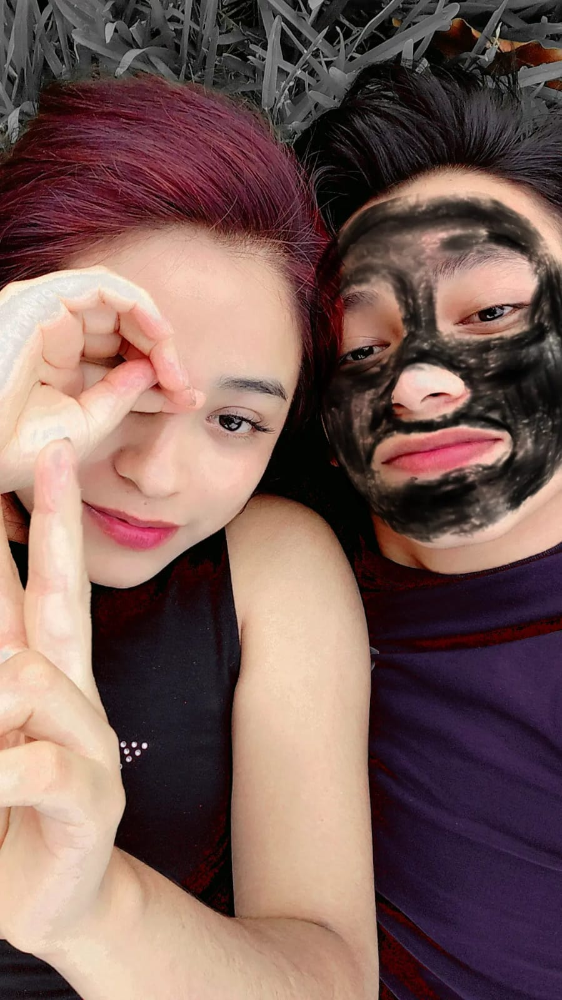

 <!DOCTYPE html>
<html lang="es">

<head>
    <meta charset="UTF-8">
    <meta name="viewport" content="width=device-width, initial-scale=1.0">
    <title>Para mi niña 💚</title>

    <link rel="stylesheet" href="style.css">
</head>

<body>
<!-- =========================================
     🔐 LOGIN INICIAL
========================================= -->
<!-- MODO MANTENIMIENTO SANTAY -->

    

        
🔒

        <h1>ACCESO SUSPENDIDO</h1>

        <h3>MODO MANTENIMIENTO</h3>

        

            El desarrollador y administrador
            ha deshabilitado temporalmente
            el acceso a esta página.
        

        

        <strong>ADMINISTRADOR</strong>

        
Santay Sebastian

        
santaysebastian799@gmail.com

        <small>Servicio temporalmente no disponible.</small>

    

    

        
💚

        <h2>Solo para mi niña</h2>

        
Hay algo aquí que solo tú puedes abrir...

        <input
            type="text"
            id="fechaInicial"
            placeholder="DD / MM"
            maxlength="5"
        >

        <button onclick="entrarPagina()">
            Entrar 💚
        </button>

        

    

    

        <!-- Estrella principal -->
        

        <!-- Título -->
        <h1 id="titulo"></h1>

        <!-- Botón -->
        <button id="btnCarta">Abrir mi corazón 💚</button>
         <audio id="musica" preload="auto" loop>
    <source src="musica.mp3" type="audio/mpeg">
</audio>
        <!-- Sobre -->
        

            

                <h2>Para mi niña 💚</h2>

                

            

        

    

    <!-- JavaScript -->
     <!-- =========================================
     🔐 SEGUNDO LOGIN
========================================= -->

    

        
🌻

        <h2>Una última cosa...</h2>

        
Si llegaste hasta aquí, sabes qué fecha poner. 💚

        <input
            type="text"
            id="fechaGaleria"
            placeholder="DD / MM"
            maxlength="5"
        >

        <button onclick="entrarGaleria()">
            Abrir mi galería 📸
        </button>

        

    

<!-- =========================================
     📸 GALERÍA
========================================= -->

<!-- =========================================
     📸 GALERÍA
========================================= -->

    <h1>Mis recuerdos contigo 💚</h1>

    

        Algunas cosas que quiero guardar contigo... 🌻
    

    

        

            

            

             NUESTRA PRIMERA FOTO 🌻💚 🌻
            

        

        

            

            

                Mi flaca 🌻
            

        

        

            

            

                Un momento especial ❤️
            

        

        

            

            

                Y los que todavía nos faltan... ✨
            

        

    

    

        Y quiero seguir llenando esta galería contigo. 💚

    

</body>
</html>

// ========================================
// 🌌 UNIVERSO PARA EUNICE
// ========================================

// ========================================
// ⭐ CREAR ESTRELLAS
// ========================================

for (let i = 0; i < 400; i++) {

    const estrella = document.createElement("div");

    estrella.classList.add("estrella");

    // Tamaños diferentes
    const tamaño = Math.random() * 4 + 1;

    estrella.style.width = tamaño + "px";
    estrella.style.height = tamaño + "px";

    // Posición aleatoria
    estrella.style.left =
        Math.random() * window.innerWidth + "px";

    estrella.style.top =
        Math.random() * window.innerHeight + "px";

    // Parpadeo diferente
    estrella.style.animationDelay =
        Math.random() * 5 + "s";

    estrella.style.animationDuration =
        Math.random() * 3 + 2 + "s";

    document.getElementById("universo")
        .appendChild(estrella);
}

// ========================================
// 🌠 ESTRELLAS FUGACES
// ========================================

function crearEstrellaFugaz() {

    const estrella = document.createElement("div");

    estrella.classList.add("estrellaFugaz");

    estrella.style.left = "-100px";

    estrella.style.top =
        Math.random() * (window.innerHeight * 0.6) + "px";

    document.getElementById("universo")
        .appendChild(estrella);

    let x = -100;

    let y = parseFloat(estrella.style.top);

    const mover = setInterval(() => {

        x += 12;
        y += 5;

        estrella.style.left = x + "px";
        estrella.style.top = y + "px";

        if (x > window.innerWidth + 100) {

            clearInterval(mover);

            estrella.remove();
        }

    }, 20);
}

// Una estrella fugaz cada cierto tiempo
setInterval(crearEstrellaFugaz, 4500);

// ========================================
// 💚 MENSAJES
// ========================================

const titulo = document.getElementById("titulo");

const mensajes = [

    "Para mi niña 💚",

    "Para mi Eunice 🌻",

    "Tengo algo que mostrarte...",

    "✨"

];

let indice = 0;

function cambiarMensaje() {

    titulo.style.opacity = "0";

    setTimeout(() => {

        titulo.innerHTML = mensajes[indice];

        titulo.style.opacity = "1";

        indice++;

        if (indice < mensajes.length) {

            setTimeout(cambiarMensaje, 2500);

        } else {

            // Cuando termina la historia
            setTimeout(() => {

                document.getElementById("btnCarta")
                    .style.display = "block";

            }, 1800);

        }

    }, 700);
}

// ========================================
// 🌻 GIRASOLES
// ========================================

function crearGirasol() {

    const girasol = document.createElement("div");

    girasol.classList.add("girasol");

    girasol.innerHTML = "🌻";

    girasol.style.left =
        Math.random() * window.innerWidth + "px";

    girasol.style.fontSize =
        Math.random() * 25 + 20 + "px";

    document.getElementById("universo")
        .appendChild(girasol);

    let y = -60;

    const velocidad =
        Math.random() * 1.5 + 0.5;

    const caer = setInterval(() => {

        y += velocidad;

        girasol.style.top = y + "px";

        if (y > window.innerHeight + 60) {

            clearInterval(caer);

            girasol.remove();
        }

    }, 20);
}

setInterval(crearGirasol, 1600);

// ========================================
// 💌 CARTA
// ========================================

const boton =
    document.getElementById("btnCarta");

const sobre =
    document.getElementById("sobre");

const texto =
    document.getElementById("textoCarta");

 boton.addEventListener("click",()=>{

    const musica = document.getElementById("musica");

    if (musica) {

        musica.volume = 0.7;

        musica.play()
            .then(() => {
                console.log("🎵 Música reproduciéndose");
            })
            .catch((error) => {
                console.log("❌ No se pudo reproducir:", error);
            });

    }

    boton.style.display="none";

    sobre.style.display="block";

    textoCarta.innerHTML=`

Mi niña...

Gracias por llegar a mi vida.

Tal vez este no sea el regalo más caro del mundo...

Pero sí uno en el que puse tiempo, cariño y muchas ganas.

Cada línea de código que ves aquí la escribí pensando en ti.

Espero que cada vez que mires las estrellas recuerdes que siempre habrá alguien que te quiere muchísimo. TE AMOOOO 💚 MI NIÑA. 
Te amo con todo mi corazón y espero que este regalo te haga sonreír tanto como tú me haces sonreír a mí. 🌻
te quiero mucho, mi flaca. 💚
Eres todo lo que quería y más. Gracias por ser tú, por tu amor y por hacerme sentir tan especial. Eres mi sol en los días nublados y mi refugio en las tormentas. No hay palabras suficientes para expresar lo agradecido que estoy de tenerte en mi vida.

Con mucho cariño...                               

  ❤️ ❤️ ❤️ SEBASTIAN  ❤️ ❤️ ❤️

`;

 

    // Después de unos segundos
    setTimeout(() => {

        crearBotonFinal();

    }, 7000);

});

// ========================================
// 🌻 BOTÓN FINAL
// ========================================

function crearBotonFinal() {

    const botonFinal =
        document.createElement("button");

    botonFinal.id = "botonFinal";

    botonFinal.innerHTML =
        "Una última cosita... 🌻";

    document.getElementById("universo")
        .appendChild(botonFinal);

    botonFinal.addEventListener("click", () => {

        sobre.style.display = "none";

        botonFinal.remove();

        mostrarFinal();

    });

}

// ========================================
// ❤️ FINAL
// ========================================

function mostrarFinal() {

     titulo.innerHTML =
    "Para mi Eunice 💚";

titulo.classList.add("tituloFinal");

titulo.style.opacity = "1";

    const final =
        document.createElement("div");

    final.id = "final";

    final.innerHTML = `

        
💚

        <h2>
            QUIERO VERLA,
            CONOCERLA,
            QUE ES NEGRA JAJAJA 😂
        </h2>

        

            Y algún día vamos a cumplir
            todas esas cosas que decimos. 🌻
        

        

            Te quiero muchísimo, mi flaca. 💚
        

    `;

    document.getElementById("universo")
        .appendChild(final);

    // Corazones flotando
    for (let i = 0; i < 15; i++) {

        setTimeout(() => {

            crearCorazon();

        }, i * 400);

    }

}

// ========================================
// 💚 CORAZONES
// ========================================

function crearCorazon() {

    const corazon =
        document.createElement("div");

    corazon.classList.add("corazonFlotante");

    corazon.innerHTML = "💚";

    corazon.style.left =
        Math.random() * window.innerWidth + "px";

    document.getElementById("universo")
        .appendChild(corazon);

    setTimeout(() => {

        corazon.remove();

    }, 5000);

}
 // =========================================
// 🔐 LOGIN INICIAL
// =========================================

function entrarPagina(){

    const fecha =
        document.getElementById("fechaInicial").value
        .trim();

    if(fecha === "30/06" || fecha === "30-06"){

        document.getElementById("loginInicial").style.display =
            "none";

        document.getElementById("universo").style.display =
            "block";

        // Iniciar la historia solamente después de entrar
        indice = 0;
        cambiarMensaje();

    }else{

        document.getElementById("errorInicial").innerHTML =
            "Mmm... esa no es la fecha, mi niña 😏💚";

    }

}

// =========================================
// 🔐 SEGUNDO LOGIN
// =========================================

function mostrarLoginGaleria(){

    const login =
        document.getElementById("loginGaleria");

    if(login){

        login.style.display = "flex";

    }

}

// =========================================
// 📸 ENTRAR A LA GALERÍA
// =========================================

function entrarGaleria(){

    const fecha =
        document.getElementById("fechaGaleria").value
        .trim();

    if(fecha === "30/06" || fecha === "30-06"){

        document.getElementById("loginGaleria").style.display =
            "none";

        document.getElementById("universo").style.display =
            "none";

        document.getElementById("galeria").style.display =
            "block";

        window.scrollTo(0,0);

    }else{

        document.getElementById("errorGaleria").innerHTML =
            "Nope 😏... piensa en nuestra fecha 💚";

    }

}

// =========================================
// 💌 DETECTAR EL FINAL DE LA HISTORIA
// =========================================
//
// Esperamos a que tu #final aparezca.
// No modificamos tu código existente.
//

const revisarFinal = setInterval(()=>{

    const final =
        document.getElementById("final");

    const login =
        document.getElementById("loginGaleria");

    if(!final || !login){

        return;

    }

    const estilo =
        window.getComputedStyle(final);

    if(
        estilo.display !== "none" &&
        estilo.visibility !== "hidden" &&
        !final.dataset.loginMostrado
    ){

        final.dataset.loginMostrado = "true";

        setTimeout(()=>{

            mostrarLoginGaleria();

        },3000);

        clearInterval(revisarFinal);

    }

},1000);
 *{
    margin:0;
    padding:0;
    box-sizing:border-box;
}

 body{
    overflow:auto;
    font-family:Arial, Helvetica, sans-serif;
    background:radial-gradient(circle,#0d1b2a,#000);
}

 #universo{
    width:100vw;
    min-height:100vh;
    position:relative;
    overflow:hidden;
}

.estrella{
    position:absolute;
    background:white;
    border-radius:50%;
    animation:parpadear 2s infinite;
}

@keyframes parpadear{

    0%{opacity:.2;}

    50%{opacity:1;}

    100%{opacity:.2;}

}

#estrellaPrincipal{

    position:absolute;

    width:14px;
    height:14px;

    left:50%;
    top:45%;

    transform:translate(-50%,-50%);

    border-radius:50%;

    background:#6CFF6C;

    box-shadow:
    0 0 20px #6CFF6C,
    0 0 50px #6CFF6C;

    animation:latido 2s infinite;

}

@keyframes latido{

    0%{transform:translate(-50%,-50%) scale(1);}

    50%{transform:translate(-50%,-50%) scale(1.5);}

    100%{transform:translate(-50%,-50%) scale(1);}

}

#titulo{
    animation:
    aparecer 3s ease,
    respirar 3s infinite;

    position:absolute;

    width:100%;

    top:90px;

    text-align:center;

    color:white;

    font-size:60px;

    text-shadow:
    0 0 10px #4CAF50,
    0 0 20px #4CAF50;

    transition:1s;

}
@keyframes respirar{

    0%{
        transform:scale(1);
    }

    50%{
        transform:scale(1.03);
    }

    100%{
        transform:scale(1);
    }

}
#btnCarta{

    display:none;

    position:absolute;

    left:50%;

    bottom:120px;

    transform:translateX(-50%);

    padding:15px 30px;

    border:none;

    border-radius:30px;

    background:#4CAF50;

    color:white;

    cursor:pointer;

    font-size:20px;

    box-shadow:0 0 20px #4CAF50;

}

  #sobre{

    display:none;

    position:absolute;

    left:50%;
    top:50%;

    transform:translate(-50%,-50%);

    width:500px;

    max-width:90%;

    max-height:70vh;

    overflow-y:auto;

    background:white;

    border-radius:20px;

    padding:35px;

    padding-bottom:90px;

    z-index:100;

    box-shadow:
        0 0 30px rgba(255,255,255,.3),
        0 0 80px rgba(76,175,80,.25);

    animation:abrirCarta .9s ease;
}
/* ========================================
   💚 TÍTULO FINAL
======================================== */

.tituloFinal{

    position:absolute !important;

    top:70px !important;

    left:50% !important;

    transform:
        translateX(-50%) !important;

    width:100% !important;

    text-align:center !important;

    font-size:65px !important;

    color:white;

    z-index:120;

    text-shadow:

        0 0 10px #4CAF50,

        0 0 25px #4CAF50,

        0 0 50px rgba(76,175,80,.7);

    animation:

        tituloFinalEntrada 2s ease;

}

@keyframes tituloFinalEntrada{

    from{

        opacity:0;

        transform:
            translateX(-50%)
            translateY(-30px)
            scale(.7);

    }

    to{

        opacity:1;

        transform:
            translateX(-50%)
            translateY(0)
            scale(1);

    }

}

#carta{

    color:#333;

    text-align:center;

}

#carta h2{

    color:#4CAF50;

    margin-bottom:20px;

}

#textoCarta{

    line-height:1.8;

}

.girasol{

    position:absolute;

    top:-50px;

    z-index:2;

    animation:girar 6s linear infinite;

}

@keyframes girar{

    from{transform:rotate(0deg);}

    to{transform:rotate(360deg);}

}
/* ========================================
   🌠 ESTRELLAS FUGACES
======================================== */

.estrellaFugaz {

    position: absolute;

    width: 5px;
    height: 5px;

    background: white;

    border-radius: 50%;

    box-shadow:
        0 0 10px white,
        0 0 20px white,
        -80px 20px 20px rgba(255,255,255,.5);

    z-index: 5;
}

/* ========================================
   🌻 GIRASOLES
======================================== */

.girasol {

    position: absolute;

    top: -60px;

    z-index: 4;

    user-select: none;

    filter:
        drop-shadow(0 0 8px rgba(255,220,50,.5));

    animation:
        girarGirasol 6s linear infinite;

}

@keyframes girarGirasol {

    from {

        transform: rotate(0deg);

    }

    to {

        transform: rotate(360deg);

    }

}

/* ========================================
   🌻 BOTÓN FINAL
======================================== */

#botonFinal {

    position: absolute;

    left: 50%;

    bottom: 35px;

    transform: translateX(-50%);

    padding: 15px 28px;

    border: none;

    border-radius: 30px;

    background: #4CAF50;

    color: white;

    font-size: 18px;

    cursor: pointer;

    z-index: 150;

    box-shadow:
        0 0 15px #4CAF50,
        0 0 30px rgba(76,175,80,.5);

    animation: aparecerBoton 1s ease;

}

@keyframes aparecerBoton {

    from {

        opacity: 0;

        transform:
            translateX(-50%)
            scale(.5);

    }

    to {

        opacity: 1;

        transform:
            translateX(-50%)
            scale(1);

    }

}

/* ========================================
   ❤️ FINAL
======================================== */

#final {

    position: absolute;

    top: 50%;

    left: 50%;

    transform:
        translate(-50%,-50%);

    width: 90%;

    max-width: 600px;

    text-align: center;

    color: white;

    z-index: 100;

    animation: aparecerFinal 2s ease;

}

#final h2 {

    font-size: 32px;

    line-height: 1.4;

    text-shadow:
        0 0 10px #4CAF50,
        0 0 25px #4CAF50;

}

#final p {

    margin-top: 20px;

    font-size: 20px;

    line-height: 1.6;

}

.corazon {

    font-size: 80px;

    animation:
        latirCorazon 1.2s infinite;

}

@keyframes latirCorazon {

    0% {

        transform: scale(1);

    }

    50% {

        transform: scale(1.25);

    }

    100% {

        transform: scale(1);

    }

}

@keyframes aparecerFinal {

    from {

        opacity: 0;

        transform:
            translate(-50%,-50%)
            scale(.5);

    }

    to {

        opacity: 1;

        transform:
            translate(-50%,-50%)
            scale(1);

    }

}

/* ========================================
   💚 CORAZONES FLOTANTES
======================================== */

.corazonFlotante {

    position: absolute;

    bottom: -50px;

    font-size: 25px;

    z-index: 200;

    animation:
        subirCorazon 5s linear forwards;

}

@keyframes subirCorazon {

    0% {

        transform:
            translateY(0)
            rotate(0deg);

        opacity: 1;

    }

    100% {

        transform:
            translateY(-110vh)
            rotate(360deg);

        opacity: 0;

    }

}
@keyframes abrirCarta{

    from{

        opacity:0;

        transform:
            translate(-50%,-50%)
            scale(.5)
            rotate(-3deg);

    }

    to{

        opacity:1;

        transform:
            translate(-50%,-50%)
            scale(1)
            rotate(0deg);

    }

}
/* ========================================
   💚 TÍTULO FINAL
======================================== */

.tituloFinal{

    position:absolute !important;

    top:70px !important;

    left:50% !important;

    transform:
        translateX(-50%) !important;

    width:100% !important;

    text-align:center !important;

    font-size:65px !important;

    color:white;

    z-index:120;

    text-shadow:

        0 0 10px #4CAF50,

        0 0 25px #4CAF50,

        0 0 50px rgba(76,175,80,.7);

    animation:

        tituloFinalEntrada 2s ease;

}

@keyframes tituloFinalEntrada{

    from{

        opacity:0;

        transform:
            translateX(-50%)
            translateY(-30px)
            scale(.7);

    }

    to{

        opacity:1;

        transform:
            translateX(-50%)
            translateY(0)
            scale(1);

    }

}
/* ========================================
   💚 TÍTULO FINAL
======================================== */

.tituloFinal{

    position:absolute !important;

    top:70px !important;

    left:50% !important;

    transform:
        translateX(-50%) !important;

    width:100% !important;

    text-align:center !important;

    font-size:65px !important;

    color:white;

    z-index:120;

    text-shadow:

        0 0 10px #4CAF50,

        0 0 25px #4CAF50,

        0 0 50px rgba(76,175,80,.7);

    animation:

        tituloFinalEntrada 4s ease;

}

@keyframes tituloFinalEntrada{

    from{

        opacity:0;

        transform:
            translateX(-50%)
            translateY(-30px)
            scale(.7);

    }

    to{

        opacity:1;

        transform:
            translateX(-50%)
            translateY(0)
            scale(1);

    }

}
 /* ========================================
   💚 TÍTULO FINAL
======================================== */

.tituloFinal{

    position:absolute !important;

    top:70px !important;

    left:50% !important;

    transform:
        translateX(-50%) !important;

    width:100% !important;

    text-align:center !important;

    font-size:65px !important;

    color:white;

    z-index:120;

    text-shadow:

        0 0 10px #4CAF50,

        0 0 25px #4CAF50,

        0 0 50px rgba(76,175,80,.7);

    animation:

        tituloFinalEntrada 2s ease;

}

@keyframes tituloFinalEntrada{

    from{

        opacity:0;

        transform:
            translateX(-50%)
            translateY(-30px)
            scale(.7);

    }

    to{

        opacity:1;

        transform:
            translateX(-50%)
            translateY(0)
            scale(1);

    }

}
/* ========================================
   📱 CELULAR
======================================== */

@media (max-width:600px){

    #titulo{

        font-size:38px;

        top:80px;

        padding:0 15px;

    }

     #sobre{

    width:90%;

    max-height:65vh;

    padding:25px;

    padding-bottom:80px;

}

    #carta h2{

        font-size:24px;

    }

    #textoCarta{

        font-size:16px;

        line-height:1.7;

    }

    .tituloFinal{

        font-size:40px !important;

        top:60px !important;

    }

    #final h2{

        font-size:23px;

    }

    #final p{

        font-size:17px;

    }

}
/* =========================================
   🔐 LOGIN
========================================= */

#loginInicial,
#loginGaleria{

    position:fixed;

    inset:0;

    background:
        radial-gradient(
            circle at center,
            #07140d 0%,
            #02050a 55%,
            #000 100%
        );

    display:flex;

    justify-content:center;

    align-items:center;

    z-index:9999;

}

#loginGaleria{

    display:none;

}

.loginCaja{

    width:380px;

    max-width:85%;

    padding:40px 30px;

    text-align:center;

    border-radius:25px;

    background:rgba(5,20,12,.85);

    border:1px solid rgba(80,255,120,.35);

    box-shadow:

        0 0 30px rgba(50,255,100,.2),

        0 0 80px rgba(50,255,100,.08);

    backdrop-filter:blur(10px);

}

.loginCorazon{

    font-size:60px;

    margin-bottom:10px;

    animation:

        latido 1.5s infinite;

}

.loginCaja h2{

    color:white;

    font-size:32px;

    margin:10px 0;

    text-shadow:

        0 0 10px #4CAF50,

        0 0 25px #4CAF50;

}

.loginCaja p{

    color:#ddd;

    font-size:16px;

    line-height:1.5;

}

.loginCaja input{

    width:80%;

    padding:14px;

    margin:20px 0 15px;

    border-radius:12px;

    border:1px solid rgba(76,175,80,.5);

    background:#020704;

    color:white;

    text-align:center;

    font-size:20px;

    outline:none;

}

.loginCaja input:focus{

    box-shadow:

        0 0 15px rgba(76,175,80,.5);

}

.loginCaja button{

    padding:13px 25px;

    border:none;

    border-radius:15px;

    background:#4CAF50;

    color:white;

    font-size:17px;

    font-weight:bold;

    cursor:pointer;

    transition:.3s;

}

.loginCaja button:hover{

    transform:scale(1.05);

    box-shadow:

        0 0 20px rgba(76,175,80,.7);

}

#errorInicial,
#errorGaleria{

    color:#ff7777;

    min-height:20px;

}

@keyframes latido{

    0%,100%{

        transform:scale(1);

    }

    50%{

        transform:scale(1.15);

    }

}

/* =========================================
   📸 GALERÍA
========================================= */

#galeria{

    display:none;

    min-height:100vh;

    padding:80px 20px;

    box-sizing:border-box;

    background:

        radial-gradient(
            circle at center,
            #07140d,
            #02050a 60%,
            #000
        );

    color:white;

    text-align:center;

}

#galeria h1{

    font-size:55px;

    margin-bottom:10px;

    text-shadow:

        0 0 10px #4CAF50,

        0 0 30px #4CAF50;

}

.subtituloGaleria{

    font-size:19px;

    color:#ddd;

    margin-bottom:45px;

}

.fotos{

    max-width:1100px;

    margin:auto;

    display:grid;

    grid-template-columns:

        repeat(auto-fit,minmax(230px,1fr));

    gap:30px;

}

.foto{

    background:rgba(255,255,255,.06);

    border:1px solid rgba(76,175,80,.3);

    border-radius:20px;

    padding:15px;

    transition:.4s;

}

.foto:hover{

    transform:translateY(-8px) scale(1.02);

    box-shadow:

        0 0 30px rgba(76,175,80,.25);

}

.foto img{

    width:100%;

    height:280px;

    object-fit:cover;

    border-radius:15px;

    display:block;

}

.foto p{

    color:white;

    font-size:17px;

    margin:15px 5px 5px;

}

.finalGaleria{

    margin-top:60px;

    font-size:22px;

    color:#eee;

}

/* =========================================
   📱 ANDROID
========================================= */

@media(max-width:600px){

    .loginCaja{

        padding:30px 20px;

    }

    .loginCaja h2{

        font-size:26px;

    }

    .loginCorazon{

        font-size:50px;

    }

    #galeria{

        padding:60px 15px;

    }

    #galeria h1{

        font-size:38px;

    }

    .subtituloGaleria{

        font-size:16px;

    }

    .foto img{

        height:300px;

    }

    .finalGaleria{

        font-size:18px;

    }

}
 
